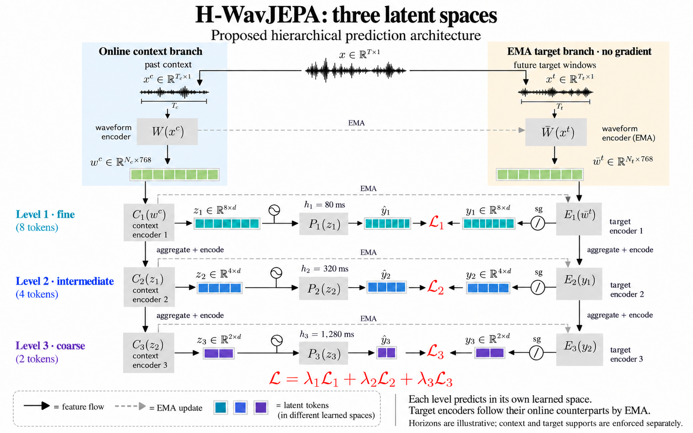

# H-WavJEPA

[](https://github.com/quangng2000/h-wavjepa/actions/workflows/tests.yml)
[](https://lightning.ai/docs/pytorch/stable/)
[](https://hydra.cc/)

A research baseline for **learned horizon-specific target spaces** on top of the official [WavJEPA](https://github.com/labhamlet/wavjepa) training core. It uses pointwise upper maps inspired by [H-JEPA](https://github.com/kevinghst/H-JEPA) and [LocaLeReg](docs/LOCALEREG.md). Experiments follow the [Lightning–Hydra template](docs/TEMPLATE.md).

The model retains masked prediction and adds three future predictors. The **pointwise baseline** transforms individual windows. A separate [temporal version](docs/TEMPORAL_AGGREGATION.md) aggregates 1/2/4 windows and adds optional within-recording variance pressure at the upper levels. Learned semantic abstraction and downstream improvement have not been demonstrated. See the [comparison boundaries](docs/UPSTREAM_DYNAMICS.md#what-the-comparisons-test).

[H-WavJEPA-Nat](docs/WAVJEPA_NAT.md) adds the official independent binaural encoders,
shared temporal masks, naturalistic room/noise rendering, and eight random
2.01-second masked crops per recording. Production requires verified Nat assets.
Four-H100 Nat throughput remains unmeasured; an explicitly waived GPU preflight
is recorded as such, and the clean mono benchmark does not qualify Nat.

The optional clean-to-Nat curriculum starts the same binaural model on clean
audio duplicated into both channels, then resumes with verified room/noise
augmentation. It preserves optimizer, EMA and step progress; it is a separate
training recipe from Nat throughout. See the [handoff guide](docs/TRAINING_SEGMENTS.md).



*Pointwise baseline sketch. The AudioSet preset uses 1.01-second windows; the long-recording preset uses 2.01 seconds. See [architecture and temporal grids](docs/UPSTREAM_DYNAMICS.md).*

## Quick start

Python 3.11–3.13 and [uv](https://docs.astral.sh/uv/):

```bash
uv sync --frozen --extra hear --extra data --extra nat
uv run python -m src.train              # tiny generated-audio smoke run
uv run --extra hear --extra data --extra nat pytest
```

The smoke run downloads no data or weights. Tests cover model, gradient, checkpoint, sampling, and distributed behavior. A two-H100 BF16 train/resume test and three full-model generated-audio updates also passed; see [validation evidence](docs/VALIDATION.md).

## Train on AudioSet

Use the [CPU preparation guide](docs/PREPARE_AUDIOSET.md) to download the pinned WavJEPA AudioSet source, convert it to mono PCM16 WAV at 16 kHz, and build recording-disjoint JSONL manifests before renting GPUs. A [rolling S3 stager](docs/STAGE_AUDIOSET.md) prepares the full corpus on a smaller CPU disk:

```json
{"path": "audio/example.wav", "recording_id": "source-recording-id"}
```

```bash
uv run python -m src.validate_data --experiment audioset_h100 \
  --train /data/audioset/train.jsonl \
  --val /data/audioset/val.jsonl --test /data/audioset/test.jsonl

uv run torchrun --standalone --nnodes=1 --nproc_per_node=2 -m src.train \
  experiment=audioset_h100 \
  data.train_manifest=/data/audioset/train.jsonl \
  data.val_manifest=/data/audioset/val.jsonl \
  data.test_manifest=/data/audioset/test.jsonl \
  hydra.run.dir=/checkpoints/hwavjepa/run-001
```

This selects DDP, BF16 mixed precision, gradient checkpointing, and 32 examples per GPU. Regularizers gather the **64-example global batch**; gradient accumulation does not enlarge that population. Training samples a new contiguous 9.09-second excerpt per epoch, so 10-second clips fit without padding. Three full-model updates on two H100 80 GB GPUs used about **29.4 GiB peak allocated memory per GPU**. Sustained AudioSet throughput and total training time still require a real-data benchmark.

For a corpus stored as staged TAR shards, use the [streaming input guide](docs/SHARDED_AUDIO.md). It reads private S3 through WebDataset and a checksum-verified, bounded local cache; no full-corpus extraction is needed.

See the [performance guide](docs/PERFORMANCE.md) for token compaction, two/four-GPU comparisons, and reliable checkpoints with streaming input.

[AudioSet guide](docs/AUDIOSET.md): manifest segments, pretrained initialization, exact timing, checkpoint resume, and evaluation. The clean hierarchy uses the original 375,000-step budget with a chronological crop recipe. The [Nat presets](docs/WAVJEPA_NAT.md) retain eight random 2.01-second masked crops and add a separate chronological hierarchy branch.

## Experiments

| Hydra experiment | Purpose |
| --- | --- |
| `audioset` | Preserved pointwise baseline, random initialization, one-device FP32 |
| `audioset_h100` | Same AudioSet experiment configured for two H100s |
| `audioset_h100_fast` / `audioset_h100_four` | Measured compact-token presets on two/four H100s, keeping global batch 64 |
| `audioset_pretrained` | AudioSet hierarchy initialized from released WavJEPA weights |
| `audioset_flat` | Matched horizons and strides, upper maps replaced by identities |
| `audioset_temporal` | Causal 1/2/4-window aggregation plus upper-space temporal variance floor |
| `audioset_temporal_h100` / `audioset_temporal_h100_fast` / `audioset_temporal_h100_four` | Temporal version with two/four-H100 execution settings; new GPU throughput unmeasured |
| `upstream_temporal_smoke` | Tiny generated-audio CPU training/evaluation of the temporal version |
| `audioset_baseline` | Masked-only control under the same nine-window AudioSet recipe |
| `audioset_baseline_h100` / `audioset_baseline_h100_fast` / `audioset_baseline_h100_four` | Masked-only controls matching the two/four-H100 execution presets |
| `audioset_nat` / `audioset_nat_h100_four` | Binaural Nat masked anchor plus temporal hierarchy; explicit BRIR/noise manifest required |
| `audioset_clean_binaural_h100_four` | Clean first phase of the Nat curriculum; same model, global 16 recordings × 8 crops |
| `audioset_nat_baseline` / `audioset_nat_baseline_h100_four` | Masked-only Nat control: global 16 recordings × 8 crops |
| `audioset_nat_pointwise` / `audioset_nat_pointwise_h100_four` | Matched Nat pointwise control, retaining the temporal penalty |
| `upstream_hierarchical` / `upstream_pretrained` | Original 18.09-second long-recording presets |
| `upstream_sigreg` / `upstream_baseline` | SIGReg and masked-objective controls on long recordings |

For pretrained two-GPU training, add `model.backbone.pretrained=true` to `audioset_h100`. This explicitly downloads pinned, checksum-verified weights (~785 MB); only fixed sinusoidal positions are regenerated for the shorter window. Learned tensors load strictly. Use `model.regularizer_kind=sigreg` for a matched regularizer control. SIGReg was introduced in [LeJEPA](https://arxiv.org/abs/2511.08544); our implementation is adapted from H-JEPA's pinned code.

Keep data, initialization, horizons, batch population, and budgets matched across comparisons. Resume with `ckpt_path=/path/last.ckpt` and a new run directory, retaining the original planned schedule.

The AudioSet masked-only control isolates the added objectives under our crop recipe; it does not reproduce the published WavJEPA recipe. The pointwise-versus-flat comparison changes target coordinates and upper-space regularization together. It cannot by itself establish that aggregation or a particular collapse-prevention mechanism caused a gain.

For a four-way comparison, independently toggle `model.aggregation_windows=[1,1,1]` versus `[1,2,2]` and `model.temporal_variance_weight=0` versus `0.1`. Existing pointwise presets keep the first choice and zero temporal weight. The [temporal guide](docs/TEMPORAL_AGGREGATION.md) specifies support, targets, controls and limitations.

Validation logs [temporal diagnostics](docs/TEMPORAL_DIAGNOSTICS.md): within/between-recording variance, persistence error, and sensitivity to context order. New flat controls regularize the shared space once; old checkpoints preserve their original loss definition.

Before hierarchy training, the [frozen-readout probe](docs/TEMPORAL_DIAGNOSTICS.md#frozen-released-weight-probe) measures the released WavJEPA window states on a reproducible local audio cohort.

## Evaluate and develop

- [HEAR](docs/HEAR.md): frozen scene/timestamp embeddings and official downstream evaluation.
- [AudioSet evaluation](docs/AUDIOSET.md#evaluation): objective diagnostics and embedding export; use one device for exact held-out coverage.
- [Validation evidence](docs/VALIDATION.md), [architecture](docs/UPSTREAM_DYNAMICS.md), and [third-party notices](THIRD_PARTY_NOTICES.md).

```text
configs/             Hydra data, model, trainer and experiment presets
src/vendor/wavjepa/  Pinned official core plus documented compatibility changes
src/models/          Active waveform hierarchy and forecasting integration
src/legacy/          Archived prototype; old import paths remain compatible
src/hear_api.py      HEAR embedding interface
evaluation/hear/     Isolated official evaluation runner
tests/               Model, causality, data, distributed and resume checks
```

```bash
uv run ruff check .
uv run ruff format --check .
```

The [legacy prototype](src/legacy/README.md) remains accessible through explicit `smoke`, `audio`, `hwavjepa`, and `flat` experiments. Its checkpoint family is separate. Active sinusoidal positions use an independently implemented formula; dependency and checkpoint provenance remain documented in the notices.

Project code is [MIT licensed](LICENSE). Vendored code and external weights retain their own terms; see [third-party notices](THIRD_PARTY_NOTICES.md).
